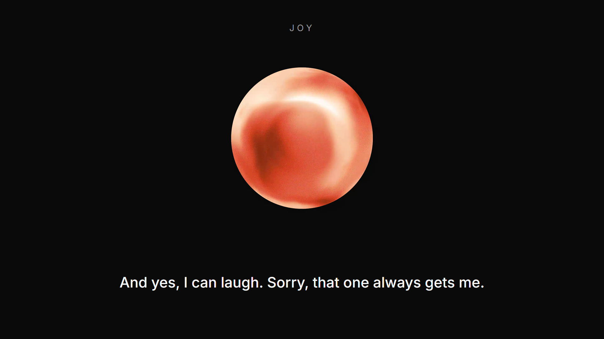
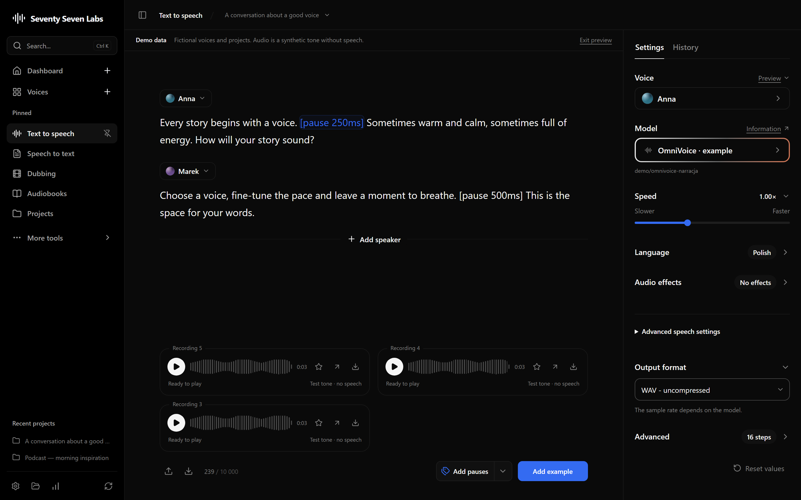
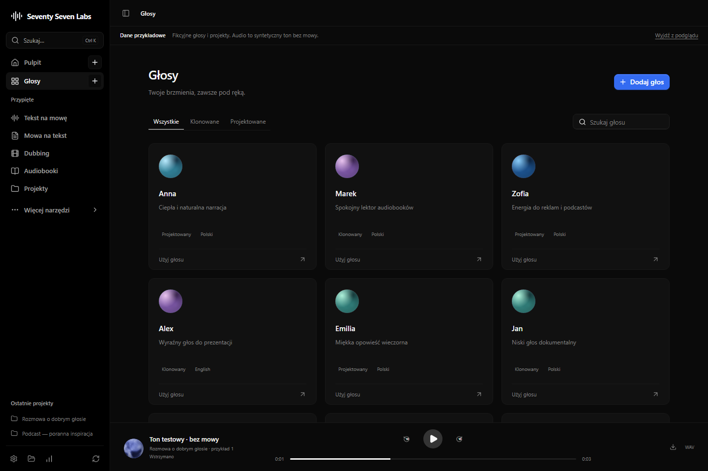
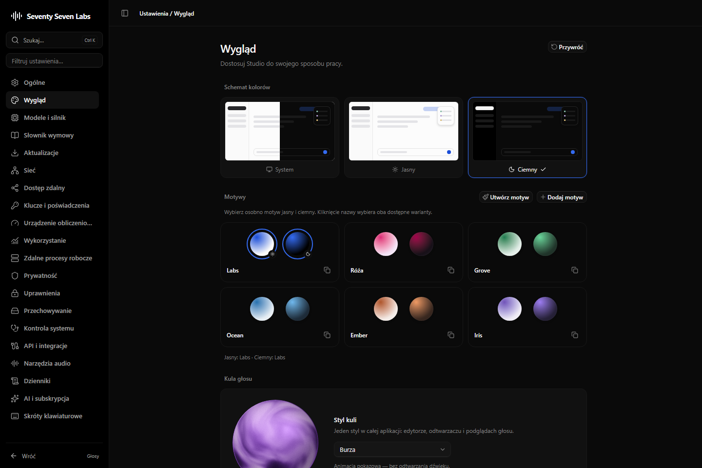

<p align="center">
  
</p>

<h1 align="center">Seventy Seven Labs</h1>

<p align="center">A free, local voice studio for Windows: type text and get natural speech, turn recordings into text and subtitles, dub videos and make audiobooks — all on your own computer.</p>

<p align="center"><a href="https://github.com/6sta3rs/77-Labs/releases/latest"><b>⬇ Download for Windows</b></a> · [glos-cały-v4.wav](https://github.com/user-attachments/files/34139184/glos-caly-v4.wav)▶ Watch the demo</a></p>

**Svelte 5 · TypeScript · Tauri 2 · Python/FastAPI · AGPL-3.0-only**

Version **0.2.4**, with an **English and Polish application interface** and English documentation. This repository includes the application source and pinned sources for the Seventy Seven Labs engine. Model weights, the Python environment, private recordings, and account data are not included.

[](docs/media/demo.mp4)

▶ [Watch the demo video](docs/media/demo.mp4): how it works, voice styles, a phone message, audiobooks, speech to text and dubbing.



## Download

Get the Windows installer (`Seventy-Seven-Labs_<version>_x64-setup.exe`) from the [latest release](https://github.com/6sta3rs/77-Labs/releases/latest). After installing, choose a CPU or NVIDIA CUDA environment and download a voice model in **Settings**; installed copies update themselves from GitHub Releases.

## Highlights

- **Everything runs locally.** The Tauri (Rust) shell starts and supervises a Python/FastAPI engine on `127.0.0.1`, shows each startup step, and stops the engine after a configurable idle time to free RAM and VRAM.
- **Try it without a GPU.** A demo mode with fictional voices shows the whole interface without models or Python.
- **Safe publishing.** A publication check scans files, nested archives and every Git object so private recordings and data never reach the public repository.
- **Model licences respected.** Each model's terms must be read and accepted before download; provenance and SHA-256 hashes are recorded for the engine sources.
- **Two interface languages.** English and Polish, with a translation catalogue checked by tests.

## Features

- A multi-speaker editor with OmniVoice tags and undo.
- Voice and TTS engine selection, playback, seeking, and export.
- A local library of projects and recordings.
- Audio transcription and transcript editing.
- Workflows for dubbing, audiobooks, and automation recipes.
- CPU/CUDA environment setup, model weights and terms, and appearance settings.

Synthesis and recognition require a configured engine and the appropriate weights. Full dubbing, long audiobooks, every model combination, and installation on a clean Windows machine still need further acceptance testing. The [PRD](docs/PRD.md) defines scope and criteria; the [verification record](docs/verification/verification.md) documents checks performed on the public release.

## Preview without models

Requirements: Node.js **22.12 or newer**, npm, and Git. Python and a GPU are not required.

```powershell
npm ci
npm run dev
```

Open **http://127.0.0.1:4310/?demo=tts**. This preview uses fictional voices, dialogues, and history. Every audio example plays the same procedural tone without human speech. It demonstrates the interface, not the output of the listed models. Demo data stays in memory.

Component gallery: **http://127.0.0.1:4310/inputy.html**. [Demo details](docs/features/tts-demo.md).



## Desktop application

Windows also requires stable Rust, the C++ tools from Visual Studio Build Tools, and WebView2. See the [Tauri prerequisites](https://v2.tauri.app/start/prerequisites/).

```powershell
npm run desktop:dev
npm run desktop:build
```

The build produces an EXE without an installer: `desktop/target/release/seventy-seven-labs.exe`.

`npm run desktop:release` builds a signed NSIS installer and the update feed for GitHub Releases; installed copies then update from **Ustawienia → Aktualizacje** (Settings → Updates). See [app updates](docs/features/app-updates.md).

The window opens without loading models. Under **Ustawienia → Silnik → Środowiska** (Settings → Engine → Environments), set up a CPU or NVIDIA CUDA environment, then download a model separately in **Ustawienia → Modele** (Settings → Models). Read and accept its terms before use. The EXE includes backend code, but not the multi-gigabyte libraries and weights. See [environment installation](docs/features/runtime-installation.md) and [engine operation](docs/architecture/runtime.md). The engine starts when the app opens (a card in the corner shows each startup step and the voice-model warm-up) and stops after the inactivity time set in **Ustawienia → Silnik → Stan** (Settings → Engine → Status; 5–60 minutes, default 15).

The browser displays the UI but does not start the Tauri supervisor. Synthesis in web development mode requires a separately running backend at `127.0.0.1:4312`.

## Data and privacy

Web projects are stored in the browser profile's localStorage/IndexedDB. Desktop engine data defaults to `%LOCALAPPDATA%/VoiceStudioNext`, outside the repository. Older directory names, storage keys, and Tauri identifiers are retained for compatibility with existing data.

The public history starts fresh with a neutral author identity. It excludes private development history, checkpoints, databases, voice samples, and recorded model-term decisions. See the [publication guide](docs/publishing.md).

Network integrations are optional. Downloading models and using a selected language service may require internet access. Only clone a voice you have permission to use. See [security](SECURITY.md).



## Development

```powershell
npm run check
npm run build
npm run test:ui
python tools/dev/publication_check.py --deny-file <private-list-outside-repo>.json
cargo check --manifest-path desktop/Cargo.toml
```

The publication check examines files, the nested engine archive, approved audio, and all Git objects, including unreachable objects. Local QA reports go into the ignored `.tmp/qa` directory. Speech tests require your own explicitly selected reference; the demo tone is for player and UI testing.

See [CONTRIBUTING.md](CONTRIBUTING.md) and the [technical context](docs/architecture/project-context.md) and the [project structure](docs/architecture/project-structure.md).

### Where do I change something?

| Area | File |
| --- | --- |
| Navigation and application composition | `frontend/src/App.svelte` |
| Editor and tags | `frontend/src/tts/SpeechEditor.svelte`, `frontend/src/tts/tags.ts` |
| Voice/model selection | `frontend/src/voices/VoicePicker.svelte`, `frontend/src/models/ModelPicker.svelte` |
| Persistent recordings | `frontend/src/projects/library.ts` |
| Player and visualization | `frontend/src/playback/Player.svelte`, `frontend/src/playback/VoiceOrb.svelte` |
| Controls and themes | `frontend/src/ui/`, `frontend/src/settings/appearance.ts`, `frontend/src/styles.css` |
| Demo data | `frontend/src/gallery/tts-demo.ts`, `public/demo/` |
| API and supervision | `frontend/src/platform/api.ts`, `desktop/src/runtime.rs` |
| Python startup and installation | `scripts/runtime/app/launcher.py`, `scripts/runtime/install/bootstrap.py` |
| Product requirements | `docs/PRD.md` |

## License and provenance

Seventy Seven Labs code is licensed under **AGPL-3.0-only** — see [LICENSE](LICENSE). Imported engine code, palettes, control styles, and language flags retain their applicable licenses and attribution. [THIRD_PARTY_NOTICES.md](THIRD_PARTY_NOTICES.md) records their origins, authors, versions, and license boundaries.

Model weights have separate terms; the application license does not grant rights to every model. Backend source and SHA-256 information are in `scripts/runtime/vendor/engine-provenance.json`.
